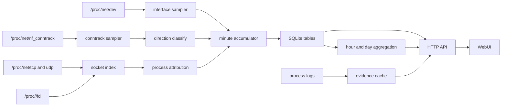

# traffic-go

`traffic-go` 是一个面向 Linux 服务器的单机流量监控和归因工具。它读取 conntrack、procfs 和配置的应用日志，按分钟记录连接增量、网卡 RX/TX、连接方向、进程、端口和对端地址。它使用同一个 Go 二进制提供采集器、SQLite 存储、JSON API 和 Web 控制台。

这个项目用于维护服务器流量台账。运维人员可以查看一台服务器在某个时间范围内产生了多少网卡接收和发送流量，也可以查看本机入站、出站和 NAT 转发连接分别由哪些进程、端口和对端地址产生。代理机、落地机、轻量网关和旧内核 VPS 都可以使用它回查流量来源。


截图使用前端 mock 数据生成。

## 设计目标

`traffic-go` 把采集、存储、聚合、查询和展示放在一个本地进程内。运行时数据写入本机 SQLite。项目不需要 eBPF、抓包程序、Prometheus、Kafka 或外置数据库。这个形态适合资源较小的 VPS，也适合只需要单机流量审计的运维场景。

系统关注连接元数据和日志证据。它记录字节数、包数、方向、协议、端口、进程和远端地址。它不会读取 payload，也不会做 DPI。`usage/explain` 会把流量明细和 nginx、Shadowsocks、FRP 等日志线索关联起来，并给出来源、目标和链路候选。这个结果用于辅助判断。

Dashboard 默认显示网卡口径。这个口径来自配置的网卡 RX/TX，适合和云服务商的流量图对比。Dashboard 也可以切换到连接方向口径。连接方向口径来自 conntrack 连接分类，适合分析本机作为客户端或服务端时的流量归属。

## 工作方式



采集器从 `/proc/net/dev` 读取网卡累计计数。`network_interfaces` 配置决定 Dashboard 网卡口径纳入哪些接口。生产环境应只填写公网网卡名，例如 `eth0`、`ens3` 或 `enp1s0`。没有配置时，系统会采集所有处于 up 状态且非 loopback 的接口。这个兼容行为可能把 Docker、VPN、隧道和 bridge 接口计入统计。

采集器从 `/proc/net/nf_conntrack` 读取连接累计字节数和包数。服务第一次看到一条连接时只建立基线，后续采集周期才计算增量。这个规则可以避免服务重启后把内核中已经累计很久的连接重新计入当前分钟。分钟数据在跨过分钟边界后会更稳定。

方向判断基于本机地址集合。远端访问本机的连接记为 `in`。本机访问远端的连接记为 `out`。经过本机转发的连接记为 `forward`。转发流量写入独立表，避免和本机进程流量混合。

进程归因基于 socket inode。TCP 连接通常更容易归属到进程。UDP、极短连接、未 connect 的 socket、代理复用和 relay 流量会降低归因稳定性。归因失败时，系统仍会保留连接统计，并用空进程字段或 `unknown` 表达边界。

## 数据保留

SQLite 中的运行表按粒度划分。`interface_1m` 保存网卡 RX/TX 分钟数据。`usage_1m` 保存普通入站和出站分钟明细。`usage_1m_forward` 保存转发分钟明细。`usage_1h`、`usage_1h_forward`、`usage_1d` 和 `usage_1d_forward` 保存聚合数据。`usage_monthly` 保存已结束自然月的摘要。`log_evidence` 保存日志证据缓存。`usage_chain_1m` 和 `usage_chain_1h` 保存物化后的归因链路。

默认保留 7 天分钟明细、3 个 UTC 自然月小时聚合、12 个 UTC 自然月日聚合。`log_evidence` 和 `usage_chain_*` 默认各保留 14 天。已结束自然月会写入 `usage_monthly`，所以 History 页面继续展示月总量、转发总量、证据数和链路数；迟到的分钟、转发、证据和链路数据也会刷新已有月摘要。跨越多个保留层的查询会拼接互不重叠的日、小时和分钟片段，因此当前尚未聚合的小时不会从长时间窗口尾部消失。若请求边界已超出分钟明细保留期，小时或日摘要会向外取整到完整 bucket；API 的 `coverage` 字段会明确返回 `approximate`、`effective_start` 和 `effective_end`，WebUI 也会提示实际覆盖窗口，避免把近似边界误认为精确区间。聚合表保留的维度少于分钟表，PID、EXE、远端端口和归因精度过滤在这些片段上不可用。

## 运行要求

服务需要运行在 Linux 上，并且需要读取 conntrack 和 procfs。主机需要加载 `nf_conntrack` 模块。内核参数 `net.netfilter.nf_conntrack_acct` 需要设置为 `1`，这样 conntrack 行才会包含字节数和包数。安装脚本会写入 `/etc/modules-load.d/traffic-go.conf` 和 `/etc/sysctl.d/99-traffic-go.conf`，立即验证配置并让它们在重启后继续生效。systemd 必须支持 `AmbientCapabilities`；安装脚本会用 `systemd-analyze verify` 检查，不能安全授权专用账号时直接停止，不会退化为以 root 运行 HTTP 服务。安装和卸载脚本还需要 GNU coreutils、`curl`、`find`、`flock`、`getfacl`、`modprobe`、`pgrep`、`readlink`、`runuser` 和 `stat` 等工具；CentOS 7 minimal 可先执行 `yum install -y acl coreutils curl findutils kmod procps-ng shadow-utils systemd util-linux`。

服务默认监听 loopback 地址。绑定到非 loopback 地址时必须配置 HTTP Basic Auth。生产环境应通过 SSH 端口转发、内网地址或带认证的反向代理访问控制台。

从源码构建前端需要 Node.js 20.19+ 或 22.12+；CI 和正式发布固定使用 `.node-version` 中的 Node.js 22.23.1 及该发行版自带的 npm 10.9.8。后端模块最低语言版本见 `go.mod`，正式发布工具链另要求 Go 1.26.5+，以避免用已知存在标准库安全修复缺口的旧 patch 版本生成产物。

## 快速开始

后端可以使用示例配置运行。配置加载器会拒绝未知字段、负的周期或保留值、非法监听地址和多文档 YAML；可以先用 `-check-config` 只做校验。

```bash
go test ./...
go run ./cmd/traffic-go -config deploy/config.example.yaml -check-config
make build
./bin/traffic-go -config deploy/config.example.yaml
```

前端开发服务器会把 `/api` 代理到后端。

```bash
npm --prefix web ci
npm --prefix web run dev -- --host 127.0.0.1
```

开发代理地址可以通过 `TRAFFIC_GO_DEV_PROXY` 覆盖。

```bash
TRAFFIC_GO_DEV_PROXY=http://127.0.0.1:18080 npm --prefix web run dev -- --host 127.0.0.1
```

前端界面可以使用 mock 数据预览。

```bash
VITE_TRAFFICGO_USE_MOCK=1 npm --prefix web run dev -- --host 127.0.0.1
```

非 Linux 环境启动后端时，collector 不写入 mock 流量。配置 `mock_data` 后才会写入演示数据。

```yaml
mock_data: true
```

## 构建和安装

常用 Make 目标覆盖后端测试、前端测试、构建、发布和本地运行。

```bash
make test-backend
make test-frontend
make build-frontend
make build
make release-linux
make run
make dev-web
```

`make build` 会先构建前端并同步到 `internal/embed/dist/`，然后使用 `-trimpath -s -w` 编译当前平台二进制。直接从只含占位文件的 clean clone 构建后端仍可用于测试，但服务启动会明确拒绝缺少 `index.html` 的不完整 WebUI；可运行产物应始终使用 `make build`。`make release-linux` 会运行前端测试、前端构建、Go 测试和 vet，并生成 `linux/amd64` 发布目录和压缩包。

Windows Git Bash 可以调用发布脚本。

```bash
bash deploy/build-linux-gitbash.sh
```

助手会优先使用仓库中被 Git 忽略的 `.tools/go/bin/go.exe`，并通过 `GOTOOLCHAIN=go1.26.5+auto` 请求正式发布所需的 patch 版本；显式设置 `GO`、`NPM` 或 `GOTOOLCHAIN` 可以覆盖这些选择。

正式发布要求固定的 Node/npm、Go 1.26.5 或更高的稳定工具链、干净工作树，并要求 HEAD 正好位于符合 SemVer 的 `v*` tag。脚本先在 `/tmp/traffic-go-release-source.*` 创建固定 commit 的 clean worktree，并把待发布输出写入 release root 内的临时 staging；只有后者必须与最终版本目录位于同一文件系统，从而在全部测试、审计、构建和校验成功后用一次目录 rename 发布到 `release/v<version>/`。已有版本目录不会被覆盖，旧成功产物不会因新构建失败而消失。二进制目录是 `release/v<version>/linux-amd64/`，压缩包是 `release/v<version>/traffic-go-v<version>-linux-amd64.tar.gz`。目录内包含 `release-manifest.json`、`BUILD-INFO.txt`、`SHA256SUMS`、Go SPDX 清单和前端生产依赖清单；manifest 和 BUILD-INFO 同时记录 Go、Node 与 npm 版本，压缩包旁另有 `.sha256`。二进制可用 `traffic-go -version` 显示版本和 commit。

发布包包含二进制、配置示例、systemd 模板和安装脚本。首次安装可以直接解压到 `/opt/traffic-go`。升级时更推荐先解压到临时目录，再通过 `TRAFFIC_GO_INSTALL_ROOT` 指向正式目录；安装器会逐个原子替换受管文件，并在 readiness 失败时恢复旧二进制、配置、unit 和数据库位置（这是带回滚的事务式升级，不是整个目录的一次 rename）。

发布包应先在普通账号下完成下载校验，再由 root 复制到只有 root 可写的 staging 目录。不要从 `/tmp`、普通用户 home 或 group/other 可写的祖先目录直接运行安装器；可信输入检查会有意拒绝这些路径。

```bash
# 普通账号：先验证下载得到的压缩包
VERSION=0.6.0
cd "release/v${VERSION}"
sha256sum -c "traffic-go-v${VERSION}-linux-amd64.tar.gz.sha256"

# root shell：复制并解压到 root-only staging，再执行安装
sudo -i
SOURCE_DIR=/path/to/traffic-go/release/v0.6.0
VERSION=0.6.0
STAGING_DIR="$(mktemp -d /root/traffic-go-release.XXXXXX)"
install -o root -g root -m 0600 \
  "${SOURCE_DIR}/traffic-go-v${VERSION}-linux-amd64.tar.gz" \
  "${STAGING_DIR}/"
tar --no-same-owner -xzf \
  "${STAGING_DIR}/traffic-go-v${VERSION}-linux-amd64.tar.gz" \
  -C "${STAGING_DIR}"
chown -R root:root "${STAGING_DIR}"
chmod -R go-w "${STAGING_DIR}"
cd "${STAGING_DIR}"
sha256sum --strict -c SHA256SUMS
TRAFFIC_GO_INSTALL_ROOT=/opt/traffic-go bash install-centos7.sh
```

安装器在修改系统前强制验证同目录的 `SHA256SUMS`。源码树内没有 manifest 时，只有显式设置 `TRAFFIC_GO_ALLOW_UNVERIFIED_PACKAGE=1` 才能继续；参数传入的自定义 binary/config/unit 不属于发布包校验范围，还需独立核验并显式设置 `TRAFFIC_GO_ALLOW_UNVERIFIED_INPUTS=1`。checksum 能发现下载或复制损坏，但如果 archive 和 checksum 来自同一个不可信渠道，它本身不能证明发布者身份；需要抗篡改来源保证时应再通过可信 CI provenance 或独立签名验证。

安装脚本会创建 `traffic-go` 专用账号、验证配置和 systemd unit、持久化 conntrack 前置条件、重启服务，并轮询 `/api/v1/readyz`。安装与卸载会在 `/run/traffic-go-install.lock` 上持有同一个 root-only 非阻塞事务锁，防止并发升级、回滚和卸载彼此覆盖。二进制和配置位于 root 所有的 `0750` 安装目录，运行数据库默认位于 service user 所有的 `0700` `/var/lib/traffic-go`，因此采集进程不能替换自己的可执行文件或配置。SQLite 主库必须是状态目录的直接子文件，WAL/SHM 也只允许位于同一目录；升级现有库前会在状态目录旁创建 root-only 的 `.traffic-go-db-rollback.*` 快照，安装成功或确认完整回滚后才清理，回滚不完整时会保留，所以升级前需为数据库副本预留磁盘空间。旧版安装在可执行目录中的 `traffic.db` 会在明确确认旧服务处于 inactive/failed 后迁移到状态目录；无法查询 systemd 状态时不会继续。失败时只有在数据库、受管文件、目录元数据、systemd reload 和 enable 状态全部恢复成功后才会重启旧服务，否则保持 stopped 并保留恢复材料供人工处理。已有 `config.yaml` 默认保留；只有显式设置 `TRAFFIC_GO_REPLACE_CONFIG=1` 才会用传入配置替换并创建备份。受管路径的叶目录必须命名为 `traffic-go` 或以 `traffic-go-`/`traffic-go_` 开头，用户 home、root、tmp、symlink 路径和其他系统树不会被接管；已有目录还必须为空、有可信管理标记或能识别为旧版布局；其整个父目录链必须由 root 持有且不能被 group/other 写入。父路径还必须允许专用账号遍历；私有路径会给出迁移或 ACL 提示并停止，不会把整个服务切换为 root。自定义状态目录可通过 `TRAFFIC_GO_STATE_DIR` 指定；规范化后的安装根、实际数据库路径和状态目录会同时记录在 root-only 本地布局文件与 `/etc/traffic-go-install-layout` 全局权威文件中。若全局权威文件已绑定到另一套布局，默认拒绝接管；只有审核迁移路径和旧服务状态后才可显式设置 `TRAFFIC_GO_ALLOW_LAYOUT_TAKEOVER=1`。

已有二进制、配置和 systemd 模板可以通过参数传入。

```bash
bash install-centos7.sh ./traffic-go ./config.yaml ./traffic-go.service
```

卸载器只有在本地管理标记、布局文件、全局权威文件以及当前 systemd unit 相互绑定时才会停服或删除任何内容；从旧安装目录或发布 staging 误运行会直接拒绝。默认移除 systemd unit、二进制以及 traffic-go 写入的 modules-load/sysctl 持久化配置；不会卸载已经加载的 `nf_conntrack` 模块，也不会立即改回当前 live sysctl 值。`config.yaml` 和备份收紧为 root-only，布局文件记录的实际 SQLite 主库及 WAL/SHM 继续保持 service user 所有且为 `0600`。默认卸载要求 `traffic-go` 账号、状态目录 owner 和 SQLite owner 仍互相匹配；异常所有权会被拒绝而不是自动纠正。nologin 专用账号也会保留，以免留下可能被 UID 重用的孤儿所有权；确认没有外部引用后可手动 `userdel traffic-go && groupdel traffic-go`。永久清除配置、已记录的实际数据库文件和管理标记必须显式请求，并在交互终端输入 `PURGE`（自动化环境还需 `--yes`）；输入不匹配会取消整个卸载，不会退化为默认删除。安装模板和卸载脚本本身会保留，便于审计和重新安装。

```bash
bash /opt/traffic-go/uninstall-centos7.sh
bash /opt/traffic-go/uninstall-centos7.sh --purge-data
# 非交互式永久清除：
bash /opt/traffic-go/uninstall-centos7.sh --purge-data --yes
```

服务状态可以用 systemd 查看。

```bash
systemctl status traffic-go.service --no-pager
journalctl -u traffic-go.service -n 100 --no-pager
curl --fail http://127.0.0.1:18080/api/v1/readyz
```

## 配置

示例配置位于 [deploy/config.example.yaml](deploy/config.example.yaml)。配置文件使用 YAML。时间字段使用 Go duration 格式，例如 `2s`、`1m` 和 `20m`。

```yaml
listen: "127.0.0.1:18080"
db_path: ./traffic.db
tick_interval: 2s
socket_index_interval: 10s
network_interfaces:
  - eth0

process_log_dirs:
  nginx: /var/log/nginx
  ss-server: /var/log/shadowsocks
  ss-manager: /var/log/shadowsocks
  obfs-server: /var/log/shadowsocks
  frps: /root/frp_0630/*.log

shadowsocks_journal_fallback: false

retention:
  minute_days: 7
  hour_months: 3
  day_months: 12
  evidence_days: 14
  chain_days: 14

prefetch:
  enabled: true
  interval: 30m
  evidence_lookback: 20m
  chain_lookback: 20m
  scan_budget: 500ms
  max_scan_files: 2
  max_scan_lines_per_file: 10000

cache:
  count_cache_size: 256
  result_cache_size: 16
  sliding_ttl: 60s
  archived_ttl: 1h
```

| 字段 | 含义 |
| --- | --- |
| `listen` | HTTP WebUI 和 API 的监听地址 |
| `db_path` | SQLite 数据库路径 |
| `tick_interval` | conntrack 采集周期 |
| `socket_index_interval` | procfs socket index 刷新周期 |
| `proc_fs` | procfs 根目录 |
| `conntrack_path` | conntrack 文件路径 |
| `network_interfaces` | Dashboard 网卡口径纳入的网卡名列表 |
| `mock_data` | 启用 mock collector |
| `auth.username` | Basic Auth 用户名 |
| `auth.password` | Basic Auth 密码 |
| `process_log_dirs` | 进程日志目录或 glob 文件模式 |
| `shadowsocks_journal_fallback` | Shadowsocks 文件日志未命中时读取 systemd journal |
| `retention.minute_days` | 分钟明细保留天数，默认 7 天 |
| `retention.hour_months` | 小时聚合保留的 UTC 自然月数量，默认 3 个月 |
| `retention.day_months` | 日聚合保留的 UTC 自然月数量，默认 12 个月 |
| `retention.evidence_days` | 日志证据缓存保留天数，默认 14 天 |
| `retention.chain_days` | 归因链路物化表保留天数，默认 14 天 |
| `prefetch.enabled` | 启用后台日志预热和链路预物化 |
| `prefetch.interval` | 后台预热周期 |
| `prefetch.evidence_lookback` | 每轮日志预热的回看窗口 |
| `prefetch.chain_lookback` | 每轮链路预物化的 usage 回看窗口 |
| `prefetch.scan_budget` | 单个日志源每轮扫描预算 |
| `prefetch.max_scan_files` | 单个日志源每轮最多扫描文件数 |
| `prefetch.max_scan_lines_per_file` | 单个文件每轮最多读取行数 |
| `cache.count_cache_size` | `/api/v1/usage` 和 `/api/v1/forward/usage` 精确总数 LRU 容量；设为 0 关闭 |
| `cache.result_cache_size` | `/api/v1/top/processes` 和 `/api/v1/top/remotes` 全量分组结果 LRU 容量；设为 0 关闭 |
| `cache.sliding_ttl` | 1h、24h、7d 等滑动窗口缓存 TTL |
| `cache.archived_ttl` | 上月、上上月等固定历史月份缓存 TTL |

`network_interfaces` 用于 Dashboard 的网卡 RX/TX 口径。要和服务商流量图对齐，应只填写公网网卡。单公网口主机通常只需要一个值，例如 `eth0`、`ens3` 或 `enp1s0`。多个公网口可以写多项。未配置时，系统会采集所有 up 且非 loopback 的网卡。有 Docker、VPN、隧道或 bridge 的机器应显式配置公网口，避免虚拟网卡重复计入。

`process_log_dirs` 的 key 使用进程名或可执行文件 basename，大小写不敏感。value 可以是目录，也可以是 glob 文件模式。多个进程可以指向同一个目录。Shadowsocks 常见组合可以把 `ss-server`、`ss-manager` 和 `obfs-server` 都指向 `/var/log/shadowsocks`。FRPS 可以指向 `/var/log/frps` 或具体的 `*.log` 模式。

分页接口默认使用内存缓存减少 SQLite 压力：`/api/v1/usage` 和 `/api/v1/forward/usage` 只有页码分页显式使用 `include_total=1` 时才计算并缓存精确 COUNT；cursor 不能与 `include_total` 混用。`/api/v1/top/processes` 与 `/api/v1/top/remotes` 会在结果不超过 5,000 行且估算不超过 8 MiB 时命中 `result_cache_size` 大小的分组结果 LRU，同一精确时间窗下换排序键或翻页可在内存完成；更大的高基数结果自动回退为 SQLite 排序分页，不进入全量缓存。两个端点各有独立的 8 MiB 硬预算，合计最多 16 MiB，避免一种查询长期占满缓存使另一种无法命中；缓存只占用进程内存，不写磁盘，任一 size 设为 0 即关闭对应缓存。

`shadowsocks_journal_fallback` 默认关闭。大多数安装应读取 `/var/log/shadowsocks` 下的文件日志。只有 Shadowsocks 仍然只写 systemd journal 的主机才需要打开它。

后台预取只把至少完整闭合一分钟的时间段推进为已处理，并在扫描命中行数或时间预算上限时保留 partial 状态供下一轮续扫。证据按小批次幂等写入，文件游标只有在全部批次成功后才发布，以免长事务阻塞采集器的分钟落盘。这个安全滞后意味着最新一分钟的日志证据和物化链路通常在下一轮预取才出现；实时流量明细本身不受影响。

后台维护任务每小时执行清理、`PRAGMA optimize` 和不会主动等待 reader 的 `wal_checkpoint(PASSIVE)`。没有 `last_vacuum_at` 的旧库首次计划维护只记录时间基线，不会突然整理整库；后续允许 vacuum 的维护轮次最多每 7 天执行一次 `VACUUM`，只有实际或显式 `VACUUM` 完成后才运行 `wal_checkpoint(TRUNCATE)`。

## 反向代理和日志归因

前端使用相对资源路径，可以挂载在任意子路径。以下配置把控制台挂载到 `/traffic/`。

```nginx
location = /traffic {
    return 301 /traffic/;
}

location /traffic/ {
    proxy_pass http://127.0.0.1:18080/;
    proxy_http_version 1.1;
    # Preserve a non-default public port so POST same-origin checks compare the
    # browser Origin against the actual external authority.
    proxy_set_header Host $http_host;
    proxy_set_header X-Real-IP $remote_addr;
    proxy_set_header X-Forwarded-For $proxy_add_x_forwarded_for;
    proxy_set_header X-Forwarded-Proto $scheme;
    proxy_set_header X-Forwarded-Prefix /traffic;
}
```

`/traffic` 需要跳转到 `/traffic/`，这样静态资源相对路径可以正确解析。`proxy_pass` 末尾保留 `/`，后端收到的是剥离子路径后的请求。

`usage/explain` 可以从 nginx access log 中提取客户端、host、path、状态码、Referer 和 User-Agent。反代场景下 access log 可能只记录 `127.0.0.1`。日志格式应写入 `xff` 和 `realip` 字段。

```nginx
log_format traffic_go '$remote_addr - - [$time_local] "$request" $status $body_bytes_sent '
                      '"$http_referer" "$http_user_agent" '
                      'xff="$http_x_forwarded_for" realip="$realip_remote_addr"';

access_log /var/log/nginx/access.log traffic_go;
```

前面存在 CDN、负载均衡或本机反代时，需要配置可信代理。

```nginx
set_real_ip_from 127.0.0.1;
set_real_ip_from ::1;
# set_real_ip_from 10.0.0.0/8;
# set_real_ip_from 172.16.0.0/12;
# set_real_ip_from 192.168.0.0/16;
real_ip_header X-Forwarded-For;
real_ip_recursive on;
```

配置完成后执行 nginx 检查和 reload。

```bash
nginx -t && systemctl reload nginx
```

`process_log_dirs.nginx` 需要指向 access log 所在目录，常见路径是 `/var/log/nginx`。

## API

所有接口挂在 `/api/v1` 下。响应使用 JSON。分页接口默认返回快速估算的 `total_rows` 和 `has_more`，并把 `total_rows_exact` 置为 `false`。需要精确总数时追加 `include_total=1`。

| 接口 | 用途 |
| --- | --- |
| `GET /api/v1/healthz` | 进程存活检查和构建版本（liveness） |
| `GET /api/v1/readyz` | SQLite 可查询、采集器已建立快照且最近采集仍新鲜（readiness） |
| `GET /api/v1/diagnostics/collector` | 采集器状态 |
| `GET /api/v1/diagnostics/store` | SQLite 连接池和表大小 |
| `GET /api/v1/processes` | 当前和近期进程建议项 |
| `GET /api/v1/stats/overview` | 连接方向总览统计 |
| `GET /api/v1/stats/monthly` | 自然月摘要 |
| `GET /api/v1/stats/timeseries` | 连接方向时序统计 |
| `GET /api/v1/stats/interfaces/timeseries` | 网卡 RX/TX 时序统计 |
| `GET /api/v1/usage` | 普通入站和出站明细 |
| `GET /api/v1/usage/explain` | 单条 usage 的归因解释 |
| `GET /api/v1/top/processes` | 进程排行 |
| `GET /api/v1/top/remotes` | 对端排行 |
| `GET /api/v1/top/ports` | 端口排行 |
| `GET /api/v1/forward/usage` | NAT 转发明细 |

时间范围可以使用 `range`，也可以使用 `start` 和 `end`。常用范围包括 `1h`、`24h`、`7d`、`this_month`、`last_month` 和 `two_months_ago`。显式时间使用 RFC3339。服务会按各层真实保留边界自动选择分钟、小时或日数据；仍在分钟保留期内的排行保留 PID 等高基数维度，跨层窗口则自动拼接可用聚合。若整个请求窗口早于所有可用明细，API 返回 `422 range_unavailable`；若所选过滤维度需要分钟明细但窗口只能由聚合层覆盖，则返回 `422 dimension_unavailable`。

```bash
LISTEN_ADDR=127.0.0.1:18080

curl "http://${LISTEN_ADDR}/api/v1/healthz"
curl "http://${LISTEN_ADDR}/api/v1/diagnostics/collector"
curl "http://${LISTEN_ADDR}/api/v1/diagnostics/store"
curl "http://${LISTEN_ADDR}/api/v1/stats/overview?range=1h"
curl "http://${LISTEN_ADDR}/api/v1/stats/interfaces/timeseries?range=1h"
curl "http://${LISTEN_ADDR}/api/v1/stats/monthly"
curl "http://${LISTEN_ADDR}/api/v1/usage?range=6h&comm=ss-server&limit=50"
curl "http://${LISTEN_ADDR}/api/v1/forward/usage?range=1h&limit=50"
```

`usage/explain` 需要传入前端明细行中的时间、方向、协议、进程和端口信息。

```bash
curl "http://${LISTEN_ADDR}/api/v1/usage/explain?ts=1710000000&data_source=usage_1m&proto=tcp&direction=out&pid=1088&comm=ss-server&exe=/usr/bin/ss-server&local_port=47920&remote_ip=198.51.100.44&remote_port=443"
```

默认情况下，`GET usage/explain` 只读取缓存证据，不产生写入。需要按需扫描文件时，必须对同一路径发送 `POST` 并追加 `scan=1`；扫描结果会写回缓存。服务对交互扫描做单并发和短时间限流，并拒绝跨 Origin 的浏览器写请求。小时和日聚合数据只回放已经持久化的链路和缓存证据。

```bash
curl -X POST "http://${LISTEN_ADDR}/api/v1/usage/explain?ts=1710000000&data_source=usage_1m&proto=tcp&direction=out&pid=1088&comm=ss-server&exe=/usr/bin/ss-server&local_port=47920&remote_ip=198.51.100.44&remote_port=443&scan=1"
```

## 排障

字节数一直为 0 时，应先检查 conntrack accounting。

```bash
sysctl net.netfilter.nf_conntrack_acct
head -n 5 /proc/net/nf_conntrack
```

新的 conntrack 行需要包含 `bytes=` 和 `packets=`。缺失时可以临时打开参数。

```bash
sysctl -w net.netfilter.nf_conntrack_acct=1
```

刚产生流量后总览仍为 0，通常和基线规则和分钟落盘有关。可以产生一段持续流量，等待一个完整分钟后再查总览。

```bash
curl -L "https://speed.cloudflare.com/__down?bytes=50000000" -o /dev/null
sleep 70
curl "http://${LISTEN_ADDR}/api/v1/stats/overview?range=1h"
```

进程归因为空时，应先查看当前连接和进程建议项。

```bash
curl "http://${LISTEN_ADDR}/api/v1/processes"
```

常见原因包括流量属于 NAT 转发，UDP socket 缺少稳定进程绑定，短连接在采集周期之间结束，运行用户没有足够权限读取 `/proc/[pid]/fd`。

启动时报 conntrack 文件不可用时，应检查文件和模块。

```bash
ls -l /proc/net/nf_conntrack
modprobe nf_conntrack
```

日志归因没有命中时，应确认配置中的进程名和实际 `comm` 或可执行文件 basename 一致，并确认日志目录可读。后台预热默认每 30 分钟执行一次，并会对普通日志文件使用 inode/offset/文件签名游标增量读取；只有完整换行的记录才会推进 offset，copytruncate 和轮转会自动重新建立游标。刚修改日志配置后可以等待下一轮预热，或对详情接口发送带 `scan=1` 的 `POST`。

## 限制

项目只支持 Linux。它依赖 conntrack 和 procfs 提供的信息。未进入 conntrack 的流量不会被采集。payload、TLS SNI、HTTP body 和完整应用协议字段不会被读取。UDP 归因只能尽力匹配。代理复用、混淆、relay、未 connect UDP 和极短连接会降低来源和目标的对应精度。内核提供真实 conntrack ID 时，连接过期后的 tuple 复用会建立新一代归因；旧内核或样例中缺少 ID 时只能合成身份，同一 tuple 在短消失窗口内的复用仍存在无法从 procfs/conntrack 文本中消除的歧义。

小时表和日表是聚合结果。长时间范围查询会减少高基数字段。`usage/explain` 的日志链路是候选证据，结果需要结合业务日志和部署拓扑判断。

## 安全和隐私

数据库包含真实流量元数据，包括进程名、可执行文件路径、远端 IP、端口、方向、字节数、包数和部分日志证据。应用会用 `0700` 创建新的数据库目录，并把 SQLite 主文件和 sidecar 收紧为 `0600`。生产环境的 `traffic.db` 不应公开分发。控制台和 API 不应直接暴露到公网；非 loopback 监听必须配置 Basic Auth，并应放在提供 TLS 的可信反向代理或 SSH 隧道后。API 默认 `no-store`，页面设置 CSP、禁止 framing、禁用 MIME sniffing，并且访问日志不会复制完整 query string。仓库通过 `.gitignore` 忽略本地数据库、发布产物、工具目录和代理运行目录。

README、测试和截图应使用 mock 或保留样例。提交问题和日志时需要清理真实 IP、域名、路径和用户标识。

## 开发验证

后端验证使用 Go 工具链。

```bash
go test ./...
go vet ./...
make build
```

前端验证使用 npm。

```bash
npm --prefix web run test
npm --prefix web run build
npm --prefix web audit --omit=dev
```

重新生成内嵌前端资源使用 Make。

```bash
make sync-frontend
```

仓库的 GitHub Actions 会在 Linux 上运行前端测试与审计、Go race 测试、vet、Staticcheck、govulncheck、CGO-free linux/amd64 构建和版本面验证，并通过 ShellCheck、actionlint 与临时 SemVer tag 完整演练不可变发布打包；Dependabot 每周检查 Go、npm 和 Actions 依赖。Web 控制台在页面可见时每 45 秒刷新，窗口重新获得焦点时补刷，并提供手动刷新和最后更新时间。

## 仓库结构

```text
traffic-go/
├── cmd/traffic-go/
├── deploy/
├── internal/api/
├── internal/app/
├── internal/collector/
├── internal/config/
├── internal/embed/
├── internal/evidence/
├── internal/model/
├── internal/store/
├── web/
├── Makefile
├── go.mod
└── README.md
```

`internal/collector` 负责内核和 procfs 采集。`internal/store` 负责 SQLite schema、写入、聚合、清理和查询。`internal/api` 负责 HTTP API、静态资源服务、日志证据扫描和归因解释。`internal/app` 负责组装 collector、store、API 和后台维护任务。`web` 是 React 控制台。`deploy` 保存发布、安装和 systemd 模板。
